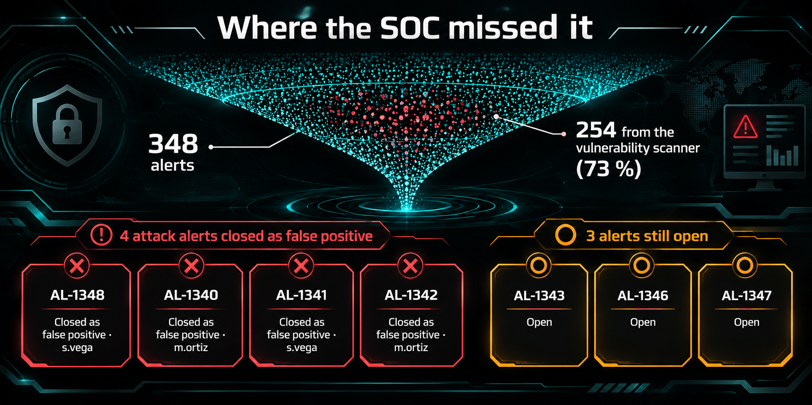
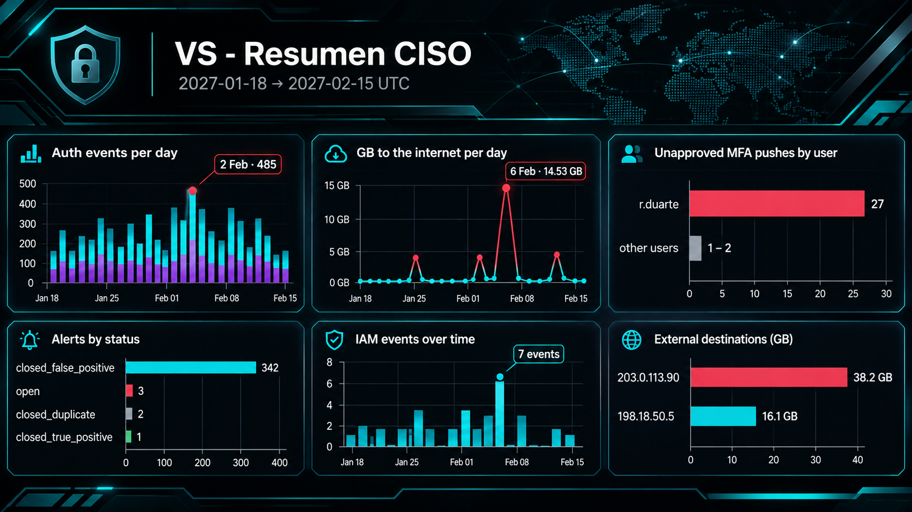

# Vértice Salud · Incident Response Assessment
### Case file VSI-2027-014 — from one phished password to 38.2 GB of patient records

---

## The case in 30 seconds

| **38.2 GB** | **62.2 %** | **7 days** | **4** |
|:---:|:---:|:---:|:---:|
| of patient records read from the cloud | of the 61.4 GB bucket | attacker active before the logs were wiped | attack-related alerts closed as false positives |

> A password typed into a fake VPN page on **1 Feb 2027 at 14:23 UTC** ended in the theft of patient records on **6–8 Feb**. Every step left evidence. Nobody put it together in time.

This is an independent, post-incident assessment: reconstruct what happened, measure the damage, audit the SOC, and say honestly what **cannot** be known. All answers are backed by repeatable ES|QL queries.

---

## Attack chain (all times UTC)

```mermaid
flowchart LR
    A["1 Feb 14:18<br/>Phishing e-mail<br/>vertlce-salud.example"] --> B["14:23:46<br/>Credentials POSTed"]
    B --> C["2 Feb 02:08-02:40<br/>27 MFA pushes<br/>unapproved"]
    C --> D["02:44:04<br/>VPN open<br/>10.99.0.17"]
    D --> E["02:58<br/>RDP to JMP-BR-01<br/>(uninventoried)"]
    E --> F["03:03-03:27<br/>Encoded PowerShell<br/>UAC bypass"]
    F --> G["03:21<br/>DNS beacon<br/>every 300 s"]
    G --> H["03:41-03:48<br/>Persistence<br/>svc32.exe"]
    H --> I["3 Feb 01:17<br/>New AWS key<br/>svc-backup-legacy"]
    I --> J["6-8 Feb 02:00-05:00<br/>38.2 GB to<br/>203.0.113.90"]
    J --> K["9 Feb 03:10<br/>Security log<br/>wiped"]
    style A fill:#0B1020,stroke:#22D3EE,color:#fff
    style B fill:#0B1020,stroke:#22D3EE,color:#fff
    style C fill:#0B1020,stroke:#A78BFA,color:#fff
    style D fill:#0B1020,stroke:#A78BFA,color:#fff
    style E fill:#0B1020,stroke:#F59E0B,color:#fff
    style F fill:#0B1020,stroke:#F59E0B,color:#fff
    style G fill:#0B1020,stroke:#F59E0B,color:#fff
    style H fill:#0B1020,stroke:#F59E0B,color:#fff
    style I fill:#0B1020,stroke:#F43F5E,color:#fff
    style J fill:#0B1020,stroke:#F43F5E,color:#fff
    style K fill:#0B1020,stroke:#F43F5E,color:#fff
```

Full table with layer and source index: [`docs/02-attack-timeline.md`](docs/02-attack-timeline.md).

---

## Where the SOC missed it

342 of 348 alerts were closed as false positives and **254 (73 %)** came from an authorised vulnerability scanner, which buried the real signal. Four attack alerts were closed incorrectly:

<b>AL-1348</b> · Suspicious URL clicked · closed by <code>s.vega</code> · 1 Feb 14:24:00

Closure reason: "no download observed". Proxy shows a `POST /vpn/renew/submit` (HTTP 302) to `vertlce-salud.example` at 14:23:46. That is **credential capture**, not malware download. This was the cheapest point to stop the whole attack.

<b>AL-1340</b> · MFA push denied repeatedly followed by approval · closed by <code>m.ortiz</code> · 2 Feb 02:44:30

Closure reason: "user confirmed by chat". The pushes came from `203.0.113.44` (NL), an IP never seen for this user (baseline: only `198.18.32.180`, BR). No chat confirmation exists in any log. The CDMX export of this alert was in UTC−6 and showed 1 Feb 20:44:30, hiding the link to the attack.

<b>AL-1341</b> · Encoded PowerShell command · closed by <code>s.vega</code> · 2 Feb 03:04:20

Ticket CHG-1187 belongs to `j.herrera`, on four MX hosts, on **4 Feb**. The alert is on `JMP-BR-01`, user `r.duarte`, on **2 Feb**, with no ticket label.

<b>AL-1342</b> · IAM access key created · closed by <code>m.ortiz</code> · 3 Feb 01:17:30

Ticket CHG-1190 is the legitimate rotation of `svc-reporting` by `a.morales` on 4 Feb (with MFA). The alerted event is `svc-etl-pipeline` creating a key for `svc-backup-legacy` on 3 Feb, with no MFA and no ticket.

Also: **AL-1343** (first large transfer) is still *open*, and **AL-1344 / AL-1345** (the next two nights, 12.7 and 11.5 GB) were closed as "duplicates" of it. They were different nights, not the same event.

---

## Exfiltration: two sources, one number

| Night (UTC) | Firewall → 203.0.113.90 | Cloud `GetObject` (new key) |
|---|---|---|
| 6 Feb | 14.0 GB · 24 flows | 148 events · 14.0 GB |
| 7 Feb | 12.7 GB · 24 flows | 134 events · 12.7 GB |
| 8 Feb | 11.5 GB · 24 flows | 121 events · 11.5 GB |
| **Total** | **38.2 GB · 72 flows** | **403 reads over 401 distinct objects · 38.2 GB** |

The cloud log alone is misleading: the source IP `192.0.2.20` is shared by 7 accounts and 2,350 normal events. Only the firewall shows **which host** sent the data and **where**. See [`E6`](exercises/E6-exfiltration/).

---

## Dashboard for the CISO

Six Lens panels: (1) auth events per day by dataset, (2) GB to the internet per day, (3) failed MFA by user, (4) alerts by status, (5) IAM events over time, (6) bytes by external destination. Specs in [`E9`](exercises/E9-ciso-dashboard/).

---

## MITRE ATT&CK mapping

| Tactic | Technique | Evidence |
|---|---|---|
| Initial Access | T1566.002 Spearphishing Link | 9 e-mails from `vertlce-salud.example` |
| Credential Access | T1621 MFA Request Generation | 27 unapproved pushes from `203.0.113.44` |
| Initial Access / Persistence | T1078 Valid Accounts | VPN + RDP as `r.duarte` |
| Execution | T1059.001 PowerShell · T1027 Obfuscation | 3 `-EncodedCommand` on JMP-BR-01 |
| Privilege Escalation | T1548.002 Bypass UAC | `fodhelper.exe` + `ms-settings` hijack |
| Persistence | T1053.005 · T1547.001 · T1136.001 | scheduled task · Run key · `svc_helpdesk` |
| Command & Control | T1071.004 DNS | `cdn-metrics-sync.example` TXT beacon |
| Persistence (cloud) | T1098.001 Additional Cloud Credentials | key `AKIAVSBKLG00NEW0001` |
| Collection | T1530 Data from Cloud Storage | 403 `GetObject` |
| Exfiltration | **T1048** Exfil Over Alternative Protocol | 38.2 GB to `203.0.113.90` |
| Defense Evasion | T1070.001 Clear Windows Event Logs | `wevtutil cl Security` |

Full mapping: [`iocs/mitre-mapping.md`](iocs/mitre-mapping.md).

---

## What we cannot know

> Calibrated conclusions weigh more than unsupported ones.

- Whether the attacker touched **FS-MX-02**: its agent was silent for 9 h 59 min, covering the whole first exfiltration night. Verdict: *cannot be determined*.
- The exact **contents** of the 401 objects read.
- What sits behind `192.0.2.20`, and what `198.18.50.5` is (a stable nightly pattern since 19 Jan, but never identified).
- The **exact time IT noticed** the log wipe: no index records it.

Details: [`docs/03-limits-of-evidence.md`](docs/03-limits-of-evidence.md).

---

## Repository map

| Path | What is inside |
|---|---|
| [`docs/`](docs/) | Case file, corrected executive summary, UTC timeline, limits, methodology |
| [`exercises/`](exercises/) | E1–E9: question → finding → repeatable ES\|QL query |
| [`detections/`](detections/) | 4 production-style ES\|QL detections with MITRE tags |
| [`iocs/`](iocs/) | Indicators (CSV) and ATT&CK mapping |
| [`assets/`](assets/) | Banner, animations, screenshots |

| Exercise | Topic |
|---|---|
| [E1](exercises/E1-hidden-assets/) | Assets missing from the inventory |
| [E2](exercises/E2-diagram-vs-flows/) | Network diagram vs. real flows |
| [E3](exercises/E3-alert-triage/) | SOC alert triage |
| [E4](exercises/E4-threat-hunting/) | Threat hunting in raw logs |
| [E5](exercises/E5-attack-chain/) | The full attack chain |
| [E6](exercises/E6-exfiltration/) | Measuring the theft |
| [E7](exercises/E7-log-gaps/) | Log gaps and evidence limits |
| [E8](exercises/E8-detection-engineering/) | Detection engineering |
| [E9](exercises/E9-ciso-dashboard/) | CISO dashboard and summary |

## How to reproduce

1. Open Kibana with the ten `vs-*` data views (`vs-auth`, `vs-endpoint`, `vs-network`, `vs-dns`, `vs-cloud`, `vs-alerts`, `vs-inventario`, `vs-cambios`, `vs-diagrama`, `vs-alertas-cdmx`).
2. Set an **absolute** time range: `2027-01-18` → `2027-02-15` (the default picker opens on a range that shows nothing).
3. Everything is in **UTC**. The CDMX alert export (`vs-alertas-cdmx`) is the one source in UTC−6.
4. Paste any `.esql` file from `exercises/*/queries/` or `detections/` into Discover → ES|QL.

> The raw dataset is **not** included in this repository.

## Disclaimer

All data is fictional. Domains end in `.example`, IPs come from documentation ranges and the keys do not exist. Do not investigate or contact any real resource.

## Author

**Leonardo Romero** · [LinkedIn](https://www.linkedin.com/in/leoromerog) · MIT License
