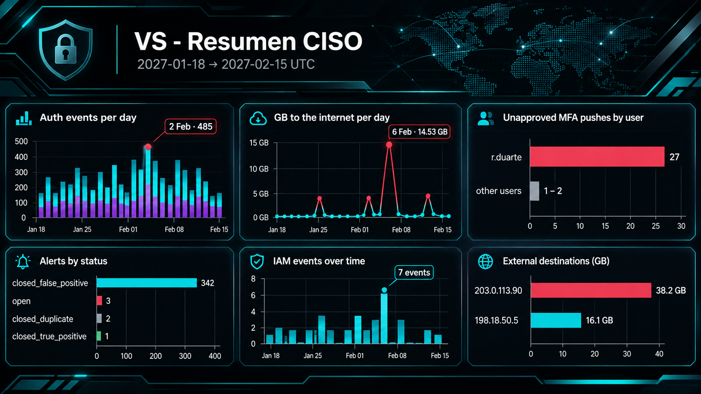

# E9 · A dashboard for the CISO
**Dashboard:** `VS - Resumen CISO` · absolute range 2027-01-18 → 2027-02-15 UTC

## Panels (Lens)
| # | Data view | Visualisation | Field / filter | Headline value |
|---|---|---|---|---|
| 1 | `vs-auth` | Stacked bars, daily | `@timestamp` by day, split by `event.dataset` | Peak 2 Feb: 485 events (then 9 Feb: 447; 26 Jan: 442) |
| 2 | `vs-network` | Line/bars, daily | `sum(network.bytes_out)/1e9` · `event.dataset: "firewall.flow"` and destination outside 10/8, 172.16/12, 192.168/16 | Peak 6 Feb: **14.53 GB** |
| 3 | `vs-auth` | Top 10 | `user.name`, count · `event.action: "mfa_push_sent"` and `mfa.result: ("timeout" or "denied")` | `r.duarte`: **27** (others 1–2) |
| 4 | `vs-alerts` | Top values | `alert.status`, count | 342 closed FP · 3 open · 2 closed duplicate · 1 closed TP |
| 5 | `vs-cloud` | Daily, split by action | `event.provider: "iam.amazonaws.example"` | 7 IAM events: 3 on 2 Feb, 1 on 3 Feb, 3 on 4 Feb |
| 6 | `vs-network` | Top 10 | `destination.ip`, sum of GB · same filter as panel 2 | `203.0.113.90`: **38.2 GB** |
| 7 *(optional)* | `vs-dns` | Top by host | `dns.question.type: "TXT"` | Beacon visible from `JMP-BR-01` |

## 9.2 · Largest day of outbound traffic
**6 Feb 2027: 14.53 GB.** Of that, **14.0 GB** is night 1 of the exfiltration (JMP-BR-01 → `203.0.113.90`); the remaining **0.53 GB** is other external traffic not broken down by destination (*open lead: group by `destination.ip` for that day*). Same pattern on 7 Feb (13.5 GB, 12.7 of it theft) and 8 Feb (11.97 GB, 11.5 of it theft). No other day exceeds 0.96 GB.

## 9.3 · The unfiltered "top destinations" panel hides the story
Unfiltered, **`10.10.30.5` (BKP-MX-01)** dominates with **1,620 GB in 153 flows**: the permitted ~60 GB nightly backup. At that scale `203.0.113.90` (38.2 GB, the theft) is only **2.4 %** of the main bar, and `198.18.50.5` (16.1 GB) is also dwarfed.

**Fix:** filter out private destinations (10/8, 172.16/12, 192.168/16), as panel 6 does, and the thief becomes #1. Keep a *separate* internal-traffic panel so lateral movement or internal staging isn't lost. A log scale would distort differences and is a worse choice for an executive view.

## 9.4 · Executive summary
See [`docs/01-executive-summary.md`](../../docs/01-executive-summary.md).
